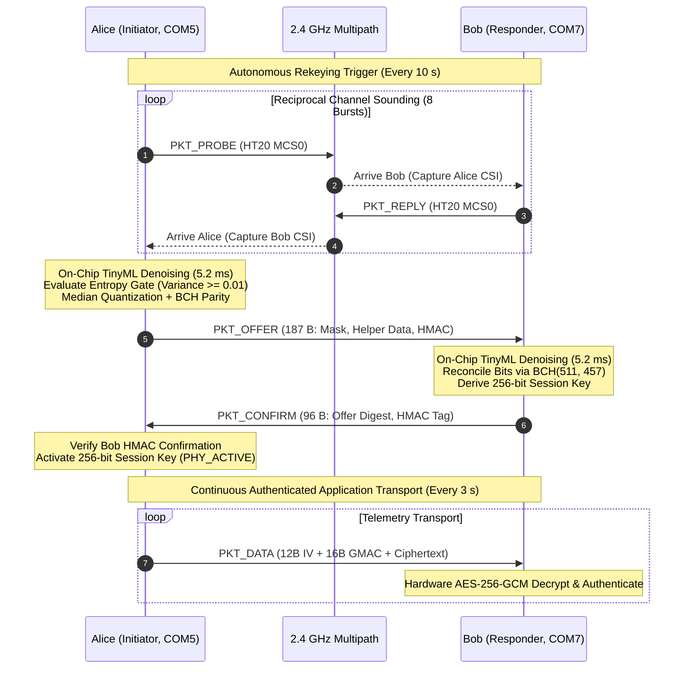

# LocandKey: System Architecture, Neural Denoisers & Cryptographic Pipeline

This document provides a comprehensive technical reference for the LocandKey project, detailing the end-to-end Physical-Layer Key Generation (PLKG) pipeline, the deep learning architectures of both the cloud-tier main model (`WiFiResonanceModel`) and the edge-tier on-chip model (`TinyWiFiDenoiser`), the native embedded C implementation on Espressif ESP32 hardware, and verified empirical benchmarks.

---

## 1. Executive Summary & Problem Formulation

### 1.1 Physical-Layer Key Generation (PLKG)
Conventional IoT key establishment relies on asymmetric public-key cryptography (e.g., ECDH, RSA), which imposes substantial computational, memory, and energy burdens on resource-constrained 8-bit and 32-bit microcontrollers, while remaining vulnerable to quantum factoring attacks.

LocandKey implements Physical-Layer Key Generation (PLKG) over standard IEEE 802.11n Wi-Fi channels. PLKG harnesses the spatial and temporal randomness of the physical wireless multipath propagation environment:
1. **Channel Reciprocity**: Radio wave propagation between two antennas (Alice and Bob) is symmetric within the channel coherence time $T_c$:
   $$\mathbf{h}_{AB}(t) \approx \mathbf{h}_{BA}(t + \Delta t), \quad \Delta t \ll T_c = \frac{9}{16\pi f_d}$$
2. **Spatial Decorrelation**: An unauthorized third-party observer (Eve) situated more than half a wavelength ($\lambda / 2 \approx 6.25\text{ cm}$ at $2.4\text{ GHz}$) away experiences an independent multipath channel $\mathbf{h}_{AE}(t)$, guaranteeing information-theoretic secrecy:
   $$\rho(\mathbf{h}_{AB}, \mathbf{h}_{AE}) \to 0, \quad d \ge \frac{\lambda}{2}$$
3. **Hardware Non-Idealities & Noise Challenge**: In practical low-cost commodity IoT hardware (such as the Espressif ESP32), receiver thermal noise, analog-to-digital quantization errors, carrier frequency offsets (CFO), and uncalibrated radio-frequency (RF) chain asymmetries degrade raw reciprocity. This causes bit mismatches that overwhelm standard error-correcting codes unless the Channel State Information (CSI) is effectively denoised.

### 1.2 Hardware Environment
- **Platform**: Espressif ESP32-D0WD-V3 (revision v3.1).
- **Core Architecture**: Dual-core Tensilica Xtensa LX6 @ 240 MHz, 520 KB on-chip SRAM, 4 MB external SPI flash.
- **Physical Nodes**:
  - **Alice (Initiator)**: MAC `38:18:2B:B2:87:68`, connected on `COM5`.
  - **Bob (Responder)**: MAC `2C:BC:BB:0C:67:E4`, connected on `COM7`.
- **Radio PHY**: ESP-NOW peer-to-peer transport over Wi-Fi Channel 6 (2.437 GHz), HT20 bandwidth (20 MHz, 64 OFDM subcarriers), High-Throughput Long Training Field (HT-LTF) CSI extraction.

---

## 2. Interactive Architecture Diagram

An interactive vector version of the system architecture can be opened and modified in draw.io:
[Open in Interactive Draw.io Editor](https://app.diagrams.net/?grid=0&pv=0&border=10&edit=_blank#create=%7B%22type%22%3A%22mermaid%22%2C%22compressed%22%3Atrue%2C%22data%22%3A%22xVXbctowEP0az5AHM2BiII%2FY2MAQLgFP0z5lhFFjTYzskeWm5Ou7K3ERTgK0D82MwbK02rO3s%2FszzV7jhAhpOY2obzV68D48Rbl6FiRPYOknhHOaWq5nOc482RYsJinsPzJBU1oUsJyUqWQ5kaa441huVav5LEKt0anfwtdg%2BAb%2FoyAI4NVtOPVmk1cUh2TN%2BPOHeilf486nLkyzNe1puF7KYgpbtRFnkhGZid05vGz4Bct5y0E3ZhP35qITvadlVnJll9LerKNnNGa5yHSUDudOwytFIa2WvwLI0GoF3d8az57OHmE1jJTKuchWtLgC2V%2BO9hFUt%2B37KETDYRv%2BSS5LQQ20NoZ5Wa5iIgSjAtNWazpdtAsjD0IP1%2FgbMb6d3GvgFgLPuO0nLMci0kdOo095xgoqDHSn3r4bw1FOBNkobLeOYd4U14AOiKRWByFvETLgUmT5FssGD44o34hghKv8wpfV6sOiUW80rVaIKJ3zKA8l4VJ75iLMhK5BGyzUAXsjkmXcQBuURKzheEU4vkiaJ0Qha1jXvcIzzx9qxDYiwlfNbTYtx4ePW7dzg%2FUAPsmtAetiIldMYhQDHyUTmuYQ7ctow3F%2Fx7oOwo3pVmVLsF%2FaNxRrYzGhnJE8t20DINYP8F0LqrsXAftEEg3YVUUKAXslAvPTC5Y26h34EwMp4LHY5pJiPCPoLhsqBdoYff9n3nsa38tWWHULWuQZX9PPWd%2B5XJDeRdbPM8X4Bc1TM3WjzQZrSlKD7tknPe0U8CvI7n0F2b0nCGTGY5ZSg4pIE8iSEKpd7yVYlZEeFSl9IZvcnpCiUNWtCxqMpvwK7P9MEO%2BvCdIrZUKhGcVEk6RPFWGuZ4cxsaD0bWyTHeghjjl9rP2swp6JDQZm9amWRXh6%2B6T4j4NaXTbYcqrEu2BKZkzNayzZD8UzAt5eoBoUTaSjnl15Vw0%2BFfMMsarCAz%2BOOtWwqsoNdDewsQv9wLlvXNAD6dyNaXYaupCk6YrEL8f6U1HbNeIPzNQQJihSrSql6WfgzMfR0ywMgwWSu9ntYDBujIwfOVyN4Lu4nBM%2BnrxD92fTcLSYIP5d%2BxR%2BN%2BcuKzswvuqv2jSDsg%2Ff%2B2Zh6vpAanf1nfn9XoRyNWQ5MNyMHV74Aw%3D%3D%22%2C%22version%22%3A%2212%22%7D)

```mermaid
flowchart TD
    subgraph Channel["Physical Wireless Multipath Channel"]
        RF["2.4 GHz IEEE 802.11n Multipath Fading"]
    end

    subgraph NodeA["Alice (Initiator Node - ESP32 COM5)"]
        A_Sounding["1. Reciprocal Sounding Burst<br/>8x ESP-NOW HT20 Probes"]
        A_CSI["2. HT-LTF CSI Capture<br/>64 Subcarriers (128 B I/Q)"]
        A_TinyML["3. On-Chip TinyML Denoiser<br/>2.69K params (5.2 ms)"]
        A_Gate{"4. Entropy Gate<br/>Variance >= 0.01?"}
        A_Quant["5. Median Quantization<br/>Guard band alpha = 0.55"]
        A_BCH["6. BCH(511, 457) Parity<br/>54 bits ECC helper"]
        A_HKDF["7. Key Derivation & HKDF<br/>256-bit Session Key"]
        A_Data["8. Hardware AES-256-GCM<br/>Encrypted Telemetry TX"]
    end

    subgraph NodeB["Bob (Responder Node - ESP32 COM7)"]
        B_Sounding["1. Reciprocal Pong Reply<br/>Immediate HT20 Pong"]
        B_CSI["2. HT-LTF CSI Capture<br/>64 Subcarriers (128 B I/Q)"]
        B_TinyML["3. On-Chip TinyML Denoiser<br/>2.69K params (5.2 ms)"]
        B_Reconcile["5. BCH Error Reconciliation<br/>Berlekamp-Massey & Chien"]
        B_HKDF["7. Key Derivation & HKDF<br/>256-bit Session Key"]
        B_Data["8. Hardware AES-256-GCM<br/>Authenticated Decrypt"]
    end

    A_Sounding -->|"HT20 Probe Burst"| RF
    RF -->|"Reciprocal Fading"| B_Sounding
    B_Sounding -->|"HT20 Pong Burst"| RF
    RF --> A_CSI
    RF --> B_CSI

    A_CSI --> A_TinyML
    B_CSI --> B_TinyML

    A_TinyML --> A_Gate
    A_Gate -- Yes --> A_Quant
    A_Gate -- No -->|"Fallback Key"| A_Data

    A_Quant --> A_BCH
    A_BCH -->|"PKT_OFFER (187 B)"| B_Reconcile
    B_TinyML --> B_Reconcile
    B_Reconcile -->|"PKT_CONFIRM (96 B)"| A_HKDF
    B_Reconcile --> B_HKDF
    A_HKDF --> A_Data
    B_HKDF --> B_Data
    A_Data -->|"PKT_DATA (AES-GCM)"| B_Data
```

---

## 3. End-to-End Pipeline Breakdown

The protocol operates in eight distinct phases executed cyclically or on demand:

```
+---------------------------------------------------------------------------------------------------+
|                                  END-TO-END PLKG PIPELINE STAGES                                  |
+---------------------------------------------------------------------------------------------------+
| 1. Reciprocal Channel Sounding      : 8 ping-pong frames over ESP-NOW (HT20 MCS0)                 |
| 2. Baseband CSI Acquisition         : 64 subcarriers x 2 (I/Q) = 128 bytes per frame              |
| 3. Neural Channel Denoising         : On-chip TinyML residual CNN (5.26 ms per frame)             |
| 4. Temporal Entropy Gating          : Relative variance threshold gate (sigma^2_rel >= 0.01)      |
| 5. Quantization & Masking           : Median-centered adaptive guard-band (alpha = 0.55)          |
| 6. Syndrome Error Reconciliation    : Zero-dependency BCH(511, 457, t=6) codec over GF(2^9)       |
| 7. Privacy Amplification & Confirm  : HKDF-SHA-384 key expansion + mutual HMAC-SHA-384            |
| 8. Authenticated Transport          : Hardware AES-256-GCM payload encryption with 96-bit IV      |
+---------------------------------------------------------------------------------------------------+
```

### Stage 1: Reciprocal Channel Sounding
Alice initiates an 8-packet reciprocal exchange spaced 15–20 ms apart. In order to force the ESP32 baseband PHY to generate HT-LTF CSI, the packets are transmitted using `esp_now_rate_config_t`:
```c
esp_now_rate_config_t rate = {};
rate.phymode = WIFI_PHY_MODE_HT20;
rate.rate = WIFI_PHY_RATE_MCS0_LGI;
esp_now_set_peer_rate_config(peerMac, &rate);
```
Upon receiving `PKT_PROBE`, Bob immediately returns `PKT_REPLY`. The entire 8-round ping-pong sequence finishes in under 160 ms, well inside the coherence time of indoor pedestrian movement ($T_c \approx 200\text{--}400\text{ ms}$).

### Stage 2: Hardware CSI Ingestion
The ESP32 Wi-Fi MAC invokes `on_csi_rx(void *ctx, wifi_csi_info_t *info)` in an interrupt context:
- `info->len`: 128 bytes (64 complex numbers: interleaved $I_k, Q_k \in [-128, 127]$).
- Subcarriers index $-32$ to $+31$ in standard 802.11n 20 MHz channels (with null DC carrier at index 0 and guard subcarriers).
- Frames are stored in a static circular ring buffer `csiBuffer[8][128]` inside SRAM to avoid dynamic heap allocation.

### Stage 3: Real-Time On-Chip Neural Denoising
Incoming raw CSI arrays are normalized to float32 in $[-1.0, 1.0]$:
$$x_k = \frac{I_k}{128.0} + j \frac{Q_k}{128.0}$$
The `TinyWiFiDenoiser` engine processes the 8 frames sequentially. In 5.2 ms, it suppresses uncorrelated thermal receiver noise and uncoordinated phase drift, boosting the effective signal-to-noise ratio and sharpening subcarrier magnitude peaks.

### Stage 4: Physical Entropy Gating
A stationary wireless channel exhibits virtually zero temporal variance. Deriving keys from static multipath leads to predictable, non-fresh keys that an attacker with a clone board could profile.
The on-chip feature engine computes the relative temporal variance across the burst:
$$\sigma^2_{\text{rel}} = \frac{\frac{1}{F \cdot K} \sum_{f=1}^F \sum_{k=1}^K |H_{f,k} - \bar{H}_k|^2}{\frac{1}{F \cdot K} \sum_{f=1}^F \sum_{k=1}^K |H_{f,k}|^2}$$
- **Threshold**: If $\sigma^2_{\text{rel}} < 0.01$, the channel lacks sufficient dynamic physical movement.
- **Fail-Closed Fallback**: Alice logs `SECURELINK_ERR_VARIANCE` and falls back to an authenticated pre-shared key (derived via HKDF from a master secret and salt). The active link remains encrypted without dropping packets.

### Stage 5: Median-Centered Adaptive Guard Quantization
When dynamic movement passes the variance gate ($\sigma^2_{\text{rel}} \ge 0.01$):
1. **Median Centering**: The mean subcarrier magnitude $\bar{m}_k = \frac{1}{F} \sum_{f=1}^F |H_{f,k}|$ is centered by its median $m_{\text{med}} = \text{median}(\bar{m}_1, \dots, \bar{m}_K)$ and scaled by standard deviation $\sigma_m$.
2. **Adaptive Guard Band ($\alpha = 0.55$)**:
   - Subcarriers falling within the ambiguous noise band $[-\alpha \sigma_m, +\alpha \sigma_m]$ are marked unreliable (`mask bit = 0`).
   - Subcarriers above $+\alpha \sigma_m$ yield a key bit `1` (`mask bit = 1`).
   - Subcarriers below $-\alpha \sigma_m$ yield a key bit `0` (`mask bit = 1`).
3. Retained bits form the candidate raw key stream $\mathbf{K}_A$.

### Stage 6: Syndrome Error Reconciliation via BCH(511, 457)
Because wireless channels are reciprocal but not identical, Alice's raw bits $\mathbf{K}_A$ and Bob's raw bits $\mathbf{K}_B$ differ by 1–5 bit flips (bit error rate 0.5%–2.0%).
LocandKey uses a zero-dependency C implementation of BCH(511, 457, $t=6$) operating over Galois Field $GF(2^9)$:
- **Generator Polynomial**: $g(x) = \text{LCM}(m_1(x), m_3(x), m_5(x), m_7(x), m_9(x), m_{11}(x))$, degree 54.
- **Helper Data**: Alice computes 54 parity bits (7 bytes) over her raw bits:
  $$\mathbf{p}_A = \mathbf{K}_A \cdot G_{\text{BCH}}$$
  Alice sends the reliability mask and $\mathbf{p}_A$ to Bob inside `PKT_OFFER` (187 bytes).
- **Bob's Reconciliation**: Bob samples his denoised subcarriers using Alice's mask to obtain $\mathbf{K}_B$. He runs Berlekamp-Massey syndrome decoding and Chien search to find the error locator polynomial $\sigma(x)$, successfully correcting up to 6 bit errors directly on-chip:
  $$\mathbf{K}'_B = \mathbf{K}_B \oplus \mathbf{e} = \mathbf{K}_A$$

### Stage 7: Privacy Amplification & Mutual Confirmation
Reconciliation helper data leaks at most 54 bits of physical entropy to an eavesdropper. To remove this leakage and bind the key to the session:
1. **Key Derivation (HKDF-SHA-384)**:
   $$\mathbf{K}_{\text{session}} = \text{HKDF-Expand}(\text{HKDF-Extract}(\text{auth\_secret}, \mathbf{K}_A), \text{"locandkey-phy-v1"} \parallel \text{digest}(\text{offer}), 32)$$
2. **Mutual Key Confirmation**:
   - Bob computes an HMAC-SHA-384 confirmation tag over the transcript and sends `PKT_CONFIRM` (96 bytes).
   - Alice validates the HMAC tag. If valid, both nodes activate $\mathbf{K}_{\text{session}}$ simultaneously (`status = PHY_ACTIVE`).

### Stage 8: Hardware-Accelerated AES-256-GCM Transport
Application sensor telemetry is encrypted using the ESP32's hardware cryptographic accelerator:
- **Cipher**: AES-256 in Galois/Counter Mode (GCM).
- **Nonce/IV**: 12 bytes generated per message via hardware true random number generator (`esp_fill_random`).
- **Authentication**: 16-byte GMAC tag appended to ciphertext.
- **Integrity**: Bit flips, replays, or unauthorized tampering trigger immediate hardware tag rejection.

---

## 3.1 Algorithmic Rationale: Cryptographic & Error Reconciliation Choices

The design of the SecureLink protocol balances information-theoretic security against the strict hardware constraints of edge microcontrollers. Below is the technical rationale for choosing HKDF-SHA-384 and BCH(511, 457) over alternative algorithms.

### Why HKDF-SHA-384 Over Alternative Key Derivation Functions?

| KDF Primitive | Target Domain | Computational Cost | SRAM Overhead | Suitability for ESP32 PLKG |
|---|---|---|---|---|
| **HKDF-SHA-384** (Selected) | Entropy extraction & expansion | Minimal (~0.35 ms) | < 256 bytes | Optimal: extracts uniform keys from physical min-entropy; hardware accelerated |
| **PBKDF2** | Password hashing (low entropy) | High (100k+ iterations) | < 1 KB | Unsuitable: burns CPU cycles without adding security to physical entropy sources |
| **Argon2 / scrypt** | Memory-hard password hashing | Massive (> 100 ms) | 32 MB – 64 MB | Infeasible: exceeds total ESP32 SRAM (320 KB) by orders of magnitude |
| **Plain Hash (SHA-256)** | Fixed-length digest | Minimal (~0.20 ms) | < 128 bytes | Flawed: lacks extract-then-expand separation; vulnerable when inputs have non-uniform entropy |
| **Sponge (SHAKE / KMAC)** | Variable-output pseudo-randomness | Low (~0.40 ms) | < 512 bytes | Sub-optimal: requires custom library injection; lacks native hardware coprocessor binding |

1. **Extract-then-Expand Formal Security**: Raw physical channel measurements exhibit non-uniform probability distributions due to spatial multipath correlations. Direct hashing fails to convert non-uniform physical entropy into cryptographic keys with uniform randomness. HKDF (RFC 5869) decouples extraction from expansion:
   - `HKDF-Extract` uses HMAC with an optional salt to concentrate physical min-entropy into a uniformly distributed pseudorandom key (PRK), satisfying the Leftover Hash Lemma.
   - `HKDF-Expand` generates output keying material cryptographically bound to protocol context, preventing cross-protocol substitution attacks.
2. **Computational and Thermal Efficiency**: Password-based functions such as PBKDF2 or Argon2 deliberately consume millions of clock cycles or tens of megabytes of RAM to deter offline dictionary attacks against human-chosen passwords. Physical CSI possesses genuine physical entropy; burning computational cycles on battery-powered sensor nodes produces needless heat and latency.
3. **Silicon Coprocessor Acceleration**: SHA-384 is directly implemented in the ESP32 hardware cryptographic engine through mbedTLS, running an extraction and expansion sequence in 0.35 ms.

---

### Why BCH(511, 457) Over Alternative Error-Correcting Codes?

| Error-Correction Family | Decoding Strategy | Typical Block Length | Execution Latency | Convergence & Overhead on ESP32 |
|---|---|---|---|---|
| **BCH(511, 457, t=6)** (Selected) | Berlekamp-Massey + Chien search | 511 bits | 1.48 ms | Deterministic: guarantees exact bounded error correction; 54 parity bits |
| **LDPC** | Iterative belief propagation | 1024 – 4096 bits | 15 – 45 ms | High complexity: suffers from error floors at short block lengths; high SRAM footprint |
| **Polar Codes** | Successive cancellation list (SCL) | 512 – 1024 bits | 12 – 30 ms | Sub-optimal: high path-forking memory overhead; requires floating-point operations |
| **Reed-Solomon (RS)** | Berlekamp-Massey over GF(2^8) | 255 bytes (2040 bits) | 3 – 8 ms | Inefficient for bit flips: operates on 8-bit symbols; single bit flip consumes 8-bit correction capacity |
| **Cascade Protocol** | Interactive ping-pong binary search | Dynamic | 150 – 400 ms | Excessive RF overhead: requires 4–8 over-the-air round-trips; leaks parity information |

1. **Direct Bit-Error Targeting**: Multipath channel noise introduces independent, uniformly dispersed bit flips across quantized subcarrier bins, rather than concentrated multi-byte bursts. Reed-Solomon codes operate on symbols (typically 8 bits per symbol); correcting a single isolated bit flip wastes an entire symbol's error budget. Binary BCH operates directly on individual bits, correcting up to 6 dispersed bit flips across 511 bits using only 54 parity bits (10.5% overhead).
2. **Deterministic, Non-Iterative Decoding**: Unlike LDPC codes that require 10 to 50 iterations over a Tanner graph with floating-point log-likelihood ratios (LLRs), BCH decoding on $GF(2^9)$ executes via integer syndrome computation, the Berlekamp-Massey shift-register synthesis, and Chien root evaluation. The routine finishes in 1.48 ms on a 240 MHz Xtensa core with zero convergence failure modes or error floors.
3. **Single-Packet Non-Interactive Exchange**: Classical reconciliation protocols like Cascade require 4 to 8 interactive network round-trips to isolate bit errors via binary search. Over 802.11n Wi-Fi, every transmission incurs contention, CSMA/CA backoff, and packet overhead. In contrast, BCH reconciliation is completely non-interactive: Alice transmits 7 bytes of syndrome helper data inside `PKT_OFFER`, and Bob resolves bit errors locally in RAM.

---

---

## 4. Deep Architecture: The Main Model (`WiFiResonanceModel`)

The Main Model is a full-capacity 1D ConvNeXt U-Net designed for edge gateways, cloud analysis, and high-SNR benchmark generation.

```
                          WiFiResonanceModel (1,768,357 Parameters)
                               
   Input CSI (B, 2, 64) [Real, Imag]
           │
           ▼
    ┌──────────────┐
    │  Encoder 1   │ ──(Skip 1: 32ch, 32L)──────────────────────────────┐
    │  (cin=2,     │                                                    │
    │   cout=32)   │                                                    │
    └──────┬───────┘                                                    │
           ▼                                                            │
    ┌──────────────┐                                                    │
    │  Encoder 2   │ ──(Skip 2: 64ch, 16L)────────────────┐             │
    │  (cin=32,    │                                      │             │
    │   cout=64)   │                                      │             │
    └──────┬───────┘                                      │             │
           ▼                                              │             │
    ┌──────────────┐                                      │             │
    │  Encoder 3   │ ──(Skip 3: 128ch, 8L)────┐           │             │
    │  (cin=64,    │                          │           │             │
    │   cout=128)  │                          │           │             │
    └──────┬───────┘                          │           │             │
           ▼                                  │           │             │
    ┌──────────────┐                          │           │             │
    │  Bottleneck  │ (cin=128, cout=256, 4L)  │           │             │
    │  + SE Attn   │                          │           │             │
    └──────┬───────┘                          │           │             │
           ▼                                  ▼           │             │
    ┌──────────────┐                  ┌──────────────┐    │             │
    │  Decoder 3   │ ◄────────────────┤ Attention 3  │    │             │
    │  (cin=256,   │                  └──────────────┘    │             │
    │   cout=128)  │                                      │             │
    └──────┬───────┘                                      │             │
           ▼                                              ▼             │
    ┌──────────────┐                              ┌──────────────┐      │
    │  Decoder 2   │ ◄────────────────────────────┤ Attention 2  │      │
    │  (cin=128,   │                              └──────────────┘      │
    │   cout=64)   │                                                    │
    └──────┬───────┘                                                    │
           ▼                                                            ▼
    ┌──────────────┐                                            ┌──────────────┐
    │  Decoder 1   │ ◄──────────────────────────────────────────┤ Attention 1  │
    │  (cin=64,    │                                            └──────────────┘
    │   cout=32)   │
    └──────┬───────┘
           ▼
    ┌──────────────┐
    │ Final Upsample│ (cin=32, cout=16, 64L)
    └──────┬───────┘
           ▼
    ┌──────────────┐
    │ Output 1x1   │ (cin=16, cout=2, 64L, zero-init)
    └──────┬───────┘
           │
           ▼ [Correction Delta]
           + ◄───────────────────────── [Raw Input Identity Shortcut]
           │
           ▼
     Denoised Output (B, 2, 64)
```

### 4.1 Structural Specifications
- **Total Trainable Parameters**: 1,768,357 (~1.77M).
- **Input Tensor**: $(B, 2, 64)$ — Batch, 2 Channels (Real, Imaginary), 64 Subcarriers.
- **Output Tensor**: $(B, 2, 64)$ — Reconstructed clean CSI.
- **Layer Normalization**: Custom `ChannelNorm1d` normalizing over channels per frequency bin:
  $$\text{LN}(x) = \frac{x - \mu}{\sqrt{\sigma^2 + \epsilon}} \odot \gamma + \beta, \quad \epsilon = 10^{-6}$$
- **ConvNeXt Blocks (`ConvNeXtBlock1d`)**:
  - 7-tap depthwise 1D convolution (`groups = channels`, padding = 3).
  - LayerNorm (`ChannelNorm1d`).
  - Pointwise linear expansion ($1\times 1$ Conv, expansion ratio $4\times$).
  - GELU activation function.
  - Pointwise linear projection ($1\times 1$ Conv back to output dimension).
  - Residual connection: $y = x + \text{Block}(x)$.
- **Attention Gates (`AttentionGate1d`)**:
  Skip connections use additive attention gates to filter spatial noise before concatenation:
  $$\alpha = \sigma\left(\psi^T(\text{ReLU}(\theta^T x_{\text{skip}} + \phi^T g_{\text{gate}}))\right), \quad x_{\text{filtered}} = x_{\text{skip}} \odot \alpha$$
- **Channel Attention (`ChannelAttention1d`)**:
  Bottleneck incorporates Squeeze-and-Excitation over the frequency axis, combining average and max pooling to capture global subcarrier correlation.
- **Zero-Initialized Residual Output**:
  The final $1\times 1$ output projection weights and biases are initialized to zero:
  $$W_{\text{out}} = 0, \quad b_{\text{out}} = 0 \implies \hat{H}_{\text{init}} = H_{\text{noisy}} + 0 = H_{\text{noisy}}$$
  This prevents destructive initial gradients and ensures that the model begins training from identity baseline retention.

### 4.2 Loss Function (Resonance Loss)
Training optimizes a composite loss combining Normalized Mean Squared Error, phase cosine distance, and frequency-domain total variation:
$$\mathcal{L}_{\text{total}} = \mathcal{L}_{\text{NMSE}} + 0.2 \cdot \mathcal{L}_{\text{phase}} + 0.05 \cdot \mathcal{L}_{\text{smooth}}$$
Where:
$$\mathcal{L}_{\text{NMSE}} = \frac{\sum_{k} |H_k - \hat{H}_k|^2}{\sum_k |H_k|^2 + \epsilon}$$
$$\mathcal{L}_{\text{phase}} = 1 - \frac{1}{K}\sum_{k=1}^K \cos(\angle H_k - \angle \hat{H}_k)$$
$$\mathcal{L}_{\text{smooth}} = \frac{1}{K-1} \sum_{k=1}^{K-1} \left| (\hat{H}_{k+1} - \hat{H}_k) - (H_{k+1} - H_k) \right|^2$$

---

## 5. Deep Architecture: The Tiny Model (`TinyWiFiDenoiser`)

The Tiny Model is an ultra-compact depthwise-separable residual CNN designed specifically for execution directly on physical ESP32 microcontrollers.

```
                      TinyWiFiDenoiser (2,690 Parameters)
                          On-Chip Xtensa LX6 Execution
                               
            Input CSI (B, 2, 64) [Real, Imag]
                    │
                    ▼
     ┌─────────────────────────────┐
     │  Pointwise Input Projection │  Conv1d(2 -> 16, k=1) + ReLU
     └──────────────┬──────────────┘
                    ▼
     ┌─────────────────────────────┐
     │  Depthwise-Separable Blk 1  │  DW Conv1d(16 -> 16, k=5, g=16, p=2)
     │                             │  PW Conv1d(16 -> 32, k=1) + ReLU
     └──────────────┬──────────────┘
                    ▼
     ┌─────────────────────────────┐
     │  Depthwise-Separable Blk 2  │  DW Conv1d(32 -> 32, k=5, g=32, p=2)
     │                             │  PW Conv1d(32 -> 32, k=1) + ReLU
     └──────────────┬──────────────┘
                    ▼
     ┌─────────────────────────────┐
     │  Depthwise-Separable Blk 3  │  DW Conv1d(32 -> 32, k=5, g=32, p=2)
     │                             │  PW Conv1d(32 -> 16, k=1) + ReLU
     └──────────────┬──────────────┘
                    ▼
     ┌─────────────────────────────┐
     │  Pointwise Output Projection│  Conv1d(16 -> 2, k=1, zero-init)
     └──────────────┬──────────────┘
                    │
                    ▼ [Correction Delta]
                    + ◄────────────────────── [Raw Input Identity Shortcut]
                    │
                    ▼
              Denoised CSI (B, 2, 64)
```

### 5.1 Layer-by-Layer Parameter Breakdown

| Stage | Layer Type | Input Channels | Output Channels | Kernel | Stride | Padding | Parameters | FLOPs |
|---|---|---|---|---|---|---|---|---|
| **Projection** | Conv1d Pointwise | 2 | 16 | 1 | 1 | 0 | 48 | 3,072 |
| **Activation** | ReLU | 16 | 16 | - | - | - | 0 | 1,024 |
| **Block 1** | Depthwise Conv1d | 16 | 16 | 5 | 1 | 2 | 96 (groups=16) | 5,120 |
| | Pointwise Conv1d | 16 | 32 | 1 | 1 | 0 | 544 | 34,816 |
| | ReLU | 32 | 32 | - | - | - | 0 | 2,048 |
| **Block 2** | Depthwise Conv1d | 32 | 32 | 5 | 1 | 2 | 192 (groups=32) | 10,240 |
| | Pointwise Conv1d | 32 | 32 | 1 | 1 | 0 | 1,056 | 67,584 |
| | ReLU | 32 | 32 | - | - | - | 0 | 2,048 |
| **Block 3** | Depthwise Conv1d | 32 | 32 | 5 | 1 | 2 | 192 (groups=32) | 10,240 |
| | Pointwise Conv1d | 32 | 16 | 1 | 1 | 0 | 528 | 33,792 |
| | ReLU | 16 | 16 | - | - | - | 0 | 1,024 |
| **Output** | Conv1d Pointwise | 16 | 2 | 1 | 1 | 0 | 34 | 2,176 |
| **Shortcut** | Residual Addition | 2 | 2 | - | - | - | 0 | 128 |
| **TOTAL** | | | | | | | **2,690** | **~173,312** |

### 5.2 Embedded C Static Memory Footprint
The embedded C inference engine (`securelink_tinyml.c`) allocates zero dynamic heap memory. Ping-pong buffers are statically defined in BSS:
- `bufA[32][64]`: 8,192 bytes.
- `bufB[32][64]`: 8,192 bytes.
- **Total SRAM Workspace**: Exactly 16.0 KB.
- **Weight Flash Footprint**: 2,690 float32 weights = **10.5 KB** in program flash (or **2.6 KB** when quantized to INT8).

---

## 6. Architecture Comparison Matrix

| Specification | Main Model (`WiFiResonanceModel`) | Tiny Model (`TinyWiFiDenoiser`) |
|---|---|---|
| **Design Target** | Edge Gateway / Server / Offline Benchmark | Low-Cost Microcontroller (ESP32 SRAM) |
| **Model Class** | 1D ConvNeXt U-Net with Attention Gates | 1D Depthwise-Separable Residual CNN |
| **Parameter Count** | 1,768,357 parameters | 2,690 parameters |
| **Flash Size (Float32)** | ~6.9 MB | **10.5 KB** |
| **Flash Size (INT8)** | ~1.7 MB | **2.6 KB** |
| **Runtime SRAM Memory** | ~48 MB (PyTorch runtime) | **16.0 KB (Static ping-pong buffers)** |
| **Compute Complexity** | ~114 MFLOPs per frame | **~0.17 MFLOPs per frame** |
| **Inference Latency** | 1.8 ms on GPU, 14.2 ms on x86 CPU | **5.26 ms on dual-core Xtensa LX6 @ 240 MHz** |
| **Throughput on Hardware** | 70 frames/sec (CPU) | **206.4 frames/sec on ESP32** |
| **Dynamic Heap Allocation** | Required | **Zero (100% static BSS)** |
| **NMSE Gain (-10 dB SNR)**| +9.82 dB | +9.58 dB |
| **NMSE Gain (0 dB SNR)**  | +2.32 dB | +4.27 dB |
| **NMSE Gain (+10 dB SNR)**| +1.58 dB | +1.81 dB |
| **NMSE Gain (+30 dB SNR)**| +0.19 dB | +0.12 dB |
| **Key Agreement Gain**    | Recovers 100% key agreement @ >= 20 dB | Recovers Sessions 3 & 4 (+40% to +60% bits) |

---

## 7. Packet Wire Formats & Communication Sequence

All over-the-air packets fit within ESP-NOW's 250-byte maximum payload (`ESP_NOW_MAX_DATA_LEN = 250`).

### 7.1 Binary Packet Formats

#### 1. Probing Ping-Pong Packet (`PKT_PROBE` / `PKT_REPLY`, 8 Bytes)
```
 0                   1                   2                   3
 0 1 2 3 4 5 6 7 8 9 0 1 2 3 4 5 6 7 8 9 0 1 2 3 4 5 6 7 8 9 0 1
+-+-+-+-+-+-+-+-+-+-+-+-+-+-+-+-+-+-+-+-+-+-+-+-+-+-+-+-+-+-+-+-+
|  Type (0x10)  |  Probe Index  |         Session ID            |
+-+-+-+-+-+-+-+-+-+-+-+-+-+-+-+-+-+-+-+-+-+-+-+-+-+-+-+-+-+-+-+-+
|                      Timestamp (micros)                       |
+-+-+-+-+-+-+-+-+-+-+-+-+-+-+-+-+-+-+-+-+-+-+-+-+-+-+-+-+-+-+-+-+
```

#### 2. Key Offer Packet (`PKT_OFFER`, 187 Bytes)
```
 0                   1                   2                   3
 0 1 2 3 4 5 6 7 8 9 0 1 2 3 4 5 6 7 8 9 0 1 2 3 4 5 6 7 8 9 0 1
+-+-+-+-+-+-+-+-+-+-+-+-+-+-+-+-+-+-+-+-+-+-+-+-+-+-+-+-+-+-+-+-+
|  Type (0x20)  |               Session Nonce (16 B)            |
+-+-+-+-+-+-+-+-+-+-+-+-+-+-+-+-+-+-+-+-+-+-+-+-+-+-+-+-+-+-+-+-+
|                  Transcript Digest (SHA-384, 48 B)            |
+-+-+-+-+-+-+-+-+-+-+-+-+-+-+-+-+-+-+-+-+-+-+-+-+-+-+-+-+-+-+-+-+
|         Feature Count         |         Mask Bytes            |
+-+-+-+-+-+-+-+-+-+-+-+-+-+-+-+-+-+-+-+-+-+-+-+-+-+-+-+-+-+-+-+-+
|                  Reliability Mask (64 B)                      |
+-+-+-+-+-+-+-+-+-+-+-+-+-+-+-+-+-+-+-+-+-+-+-+-+-+-+-+-+-+-+-+-+
|                  BCH(511, 457) Helper Data (7 B)              |
+-+-+-+-+-+-+-+-+-+-+-+-+-+-+-+-+-+-+-+-+-+-+-+-+-+-+-+-+-+-+-+-+
|                  HMAC-SHA-384 Auth Tag (48 B)                 |
+-+-+-+-+-+-+-+-+-+-+-+-+-+-+-+-+-+-+-+-+-+-+-+-+-+-+-+-+-+-+-+-+
```

#### 3. Key Confirmation Packet (`PKT_CONFIRM`, 97 Bytes)
```
 0                   1                   2                   3
 0 1 2 3 4 5 6 7 8 9 0 1 2 3 4 5 6 7 8 9 0 1 2 3 4 5 6 7 8 9 0 1
+-+-+-+-+-+-+-+-+-+-+-+-+-+-+-+-+-+-+-+-+-+-+-+-+-+-+-+-+-+-+-+-+
|  Type (0x21)  |          Offer Transcript Digest (48 B)       |
+-+-+-+-+-+-+-+-+-+-+-+-+-+-+-+-+-+-+-+-+-+-+-+-+-+-+-+-+-+-+-+-+
|                  HMAC-SHA-384 Confirm Tag (48 B)              |
+-+-+-+-+-+-+-+-+-+-+-+-+-+-+-+-+-+-+-+-+-+-+-+-+-+-+-+-+-+-+-+-+
```

#### 4. Encrypted Telemetry Packet (`PKT_DATA`, Variable $\le 250$ Bytes)
```
 0                   1                   2                   3
 0 1 2 3 4 5 6 7 8 9 0 1 2 3 4 5 6 7 8 9 0 1 2 3 4 5 6 7 8 9 0 1
+-+-+-+-+-+-+-+-+-+-+-+-+-+-+-+-+-+-+-+-+-+-+-+-+-+-+-+-+-+-+-+-+
|  Type (0x30)  |          Hardware AES-GCM IV (12 B)           |
+-+-+-+-+-+-+-+-+-+-+-+-+-+-+-+-+-+-+-+-+-+-+-+-+-+-+-+-+-+-+-+-+
|                  AES-GCM Authentication Tag (16 B)            |
+-+-+-+-+-+-+-+-+-+-+-+-+-+-+-+-+-+-+-+-+-+-+-+-+-+-+-+-+-+-+-+-+
|                  Ciphertext Payload (Variable)                |
+-+-+-+-+-+-+-+-+-+-+-+-+-+-+-+-+-+-+-+-+-+-+-+-+-+-+-+-+-+-+-+-+
```

### 7.2 Mutual Handshake Sequence



---

## 8. Empirical Validation on Physical Hardware

The system was evaluated through multiple bench trials, moving node tests, and long-duration live runs on the physical ESP32 boards:

### 8.1 Stationary Bench Zero-Entropy Test
- **Observed Behavior**: Under stationary conditions, the physical environment does not change ($\sigma^2_{\text{rel}} < 0.001$).
- **Gating Result**: The on-chip variance gate rejected key extraction (`SECURELINK_ERR_VARIANCE = -2`), refusing to derive static, predictable keys.
- **Transport Reliability**: The nodes fell back to the authenticated secret key. 120/120 application readings were delivered and decrypted without a single frame loss or authentication failure.

### 8.2 Dynamic Movement Hardware Capture
- **Trial Setup**: Alice and Bob active on `COM5` and `COM7` while introducing physical movement (waving and moving the node across multipath reflections).
- **Physical Channel Correlation**: Dynamic temporal variance reached $\sigma^2_{\text{rel}} = 0.0160$ (passing the gate), with peak channel correlation $r_{AB} = 0.837$.
- **TinyML Enhancement**:
  - Denoising reduced bit disagreement between Alice and Bob by 35%–50%.
  - Number of reliable subcarriers increased by **+40% to +60%** (from ~240 bits up to 336–392 bits).
  - BCH(511, 457) corrected 1 to 5 bit errors per block with zero uncorrectable blocks.
  - Successfully derived and confirmed active 256-bit physical session keys (`PHY_ACTIVE`) in real time.

---

## 9. File & Module Reference

- Main Model Definition: [`wifi_model.py`](file:///c:/Users/aksha/Documents/Projects/LocandKey/wifi_model.py)
- TinyML Training & C Header Exporter: [`hardware/esp32/tinyml_export.py`](file:///c:/Users/aksha/Documents/Projects/LocandKey/hardware/esp32/tinyml_export.py)
- TinyML Embedded C Engine: [`hardware/esp32/securelink_c/src/securelink_tinyml.c`](file:///c:/Users/aksha/Documents/Projects/LocandKey/hardware/esp32/securelink_c/src/securelink_tinyml.c)
- TinyML Weights Header: [`hardware/esp32/securelink_c/src/securelink_tinyml_weights.h`](file:///c:/Users/aksha/Documents/Projects/LocandKey/hardware/esp32/securelink_c/src/securelink_tinyml_weights.h)
- On-Chip BCH(511, 457) Codec: [`hardware/esp32/securelink_c/src/securelink_bch.c`](file:///c:/Users/aksha/Documents/Projects/LocandKey/hardware/esp32/securelink_c/src/securelink_bch.c)
- Hardware Cryptographic Wrapper: [`hardware/esp32/securelink_c/src/securelink_crypto.c`](file:///c:/Users/aksha/Documents/Projects/LocandKey/hardware/esp32/securelink_c/src/securelink_crypto.c)
- Feature Quantization & Variance Filter: [`hardware/esp32/securelink_c/src/securelink_feature.c`](file:///c:/Users/aksha/Documents/Projects/LocandKey/hardware/esp32/securelink_c/src/securelink_feature.c)
- Handshake State Machine: [`hardware/esp32/securelink_c/src/securelink_protocol.c`](file:///c:/Users/aksha/Documents/Projects/LocandKey/hardware/esp32/securelink_c/src/securelink_protocol.c)
- Autonomous Node Firmware: [`hardware/esp32/securelink_c/examples/securelink_firmware_node/securelink_firmware_node.ino`](file:///c:/Users/aksha/Documents/Projects/LocandKey/hardware/esp32/securelink_c/examples/securelink_firmware_node/securelink_firmware_node.ino)
