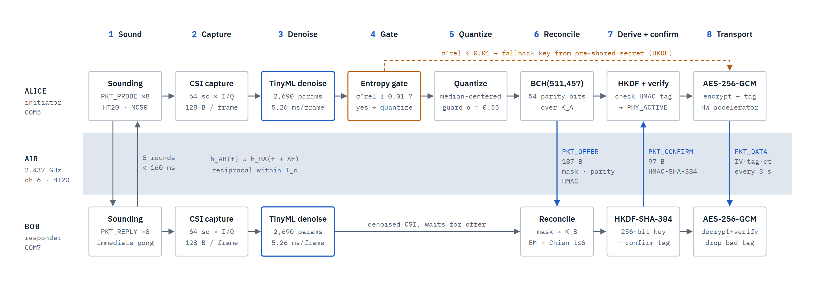
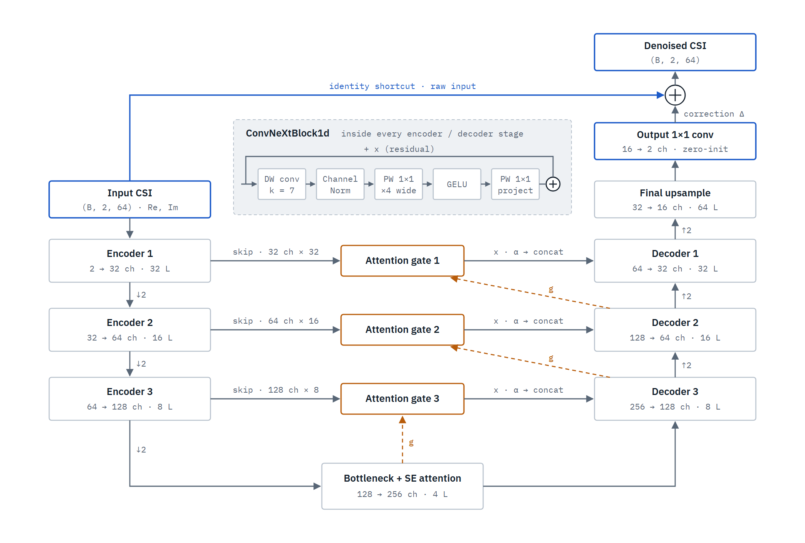
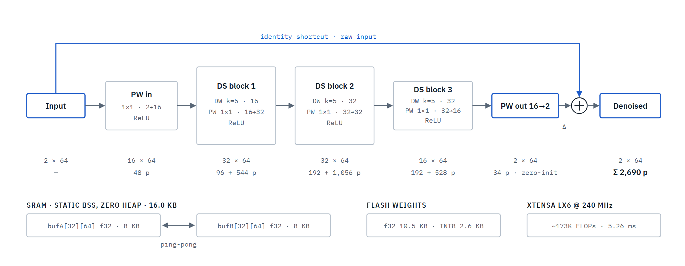

# LocandKey SecureLink

**LocandKey SecureLink** is an end-to-end Physical-Layer Key Generation (PLKG) and autonomous rekeying system engineered for pre-paired 2.4 GHz Wi-Fi Internet of Things (IoT) transceivers. The system harnesses radio propagation reciprocity from IEEE 802.11n Channel State Information (CSI), suppresses receiver phase and thermal noise through dual-tier neural denoisers, reconciles physical bit disagreement using an embedded Bose-Chaudhuri-Hocquenghem (BCH) error-correcting codec, and secures application telemetry via hardware-accelerated AES-256-GCM.

The project encompasses a continuous physical multipath channel simulator, a 1.77M-parameter gateway ConvNeXt U-Net denoiser, an ultra-lightweight 2,690-parameter on-device TinyML denoiser running bare-metal on Espressif ESP32 microcontrollers in 5.26 ms, and verified physical hardware movement runs across dual wireless nodes.

---

## Table of Contents

- [1. System Overview](#1-system-overview)
- [2. Physical Foundations & Mathematical Principles](#2-physical-foundations--mathematical-principles)
- [3. System Architecture Diagram](#3-system-architecture-diagram)
- [4. The 8-Stage SecureLink Pipeline](#4-the-8-stage-securelink-pipeline)
  - [4.1 Algorithmic Rationale: Why HKDF and BCH?](#41-algorithmic-rationale-why-hkdf-and-bch)
- [5. Dual-Tier Neural Denoisers](#5-dual-tier-neural-denoisers)
  - [5.1 Gateway Tier: WiFiResonanceModel (1.77M Parameters)](#51-gateway-tier-wifiresonancemodel-177m-parameters)
  - [5.2 Bare-Metal Edge Tier: TinyWiFiDenoiser (2.69K Parameters)](#52-bare-metal-edge-tier-tinywifidenoiser-269k-parameters)
  - [5.3 Gate-Aware Checkpoint Promotion](#53-gate-aware-checkpoint-promotion)
- [6. Empirical Benchmarks & Performance Metrics](#6-empirical-benchmarks--performance-metrics)
  - [6.1 Denoising Impact on Bit Agreement (Simulation & Physical Hardware)](#61-denoising-impact-on-bit-agreement-simulation--physical-hardware)
  - [6.2 Computational Complexity, Memory Footprint & Latency Budget](#62-computational-complexity-memory-footprint--latency-budget)
  - [6.3 Operational Velocity Limits, Doppler Spread & Coherence Bounds](#63-operational-velocity-limits-doppler-spread--coherence-bounds)
  - [6.4 Correlated Eavesdropper Secrecy Analysis](#64-correlated-eavesdropper-secrecy-analysis)
- [7. Embedded Hardware Implementation (ESP32)](#7-embedded-hardware-implementation-esp32)
  - [7.1 Transceiver Hardware & Pin Configuration](#71-transceiver-hardware--pin-configuration)
  - [7.2 Native Embedded C Library (libsecurelink)](#72-native-embedded-c-library-libsecurelink)
  - [7.3 Protocol Wire Packet Formats](#73-protocol-wire-packet-formats)
  - [7.4 Live Serial Execution Transcript](#74-live-serial-execution-transcript)
- [8. Repository Structure](#8-repository-structure)
- [9. Quickstart & Verification Guide](#9-quickstart--verification-guide)
  - [9.1 Interactive Step-by-Step Demonstration](#91-interactive-step-by-step-demonstration)
  - [9.2 Python Simulation & Protocol Suite](#92-python-simulation--protocol-suite)
  - [9.3 Physical ESP32 Hardware Tests](#93-physical-esp32-hardware-tests)
  - [9.4 Compiling the Academic Project Report](#94-compiling-the-academic-project-report)
- [10. Formal System Verification Manifest](#10-formal-system-verification-manifest)

---

## 1. System Overview

Traditional IoT key establishment relies on asymmetric public-key cryptography (such as ECDH or RSA), which consumes significant compute cycles, memory, and energy on 32-bit microcontrollers while facing long-term vulnerabilities to quantum factoring algorithms. 

Physical-Layer Key Generation (PLKG) derives cryptographic secrets directly from the unique, time-varying radio propagation characteristics shared between two transceivers. However, practical deployment on low-cost commodity IoT hardware introduces three engineering hurdles:
1. **Radio Asymmetry and Measurement Noise**: Inexpensive RF front-ends exhibit non-simultaneous ping-pong delays, carrier frequency offsets, and uncalibrated receiver gain slopes, corrupting raw Channel State Information (CSI) and causing high bit error rates.
2. **Static Environments and Profile Vulnerabilities**: When IoT nodes remain stationary, multipath channels lack temporal entropy. Generating keys from static channels produces predictable keys vulnerable to adversarial profiling.
3. **Severe Embedded Constraints**: Resource-constrained microcontrollers like the Espressif ESP32 cannot run heavy deep learning runtimes (e.g., PyTorch, TensorFlow Lite) or allocate large heap buffers without risking FreeRTOS stack canary panics.

LocandKey SecureLink resolves these challenges with:
- A continuous physical multipath channel simulator modeling 2.4 GHz IEEE 802.11n OFDM channels with Doppler shifts and RF impairments.
- An ultra-lightweight **TinyML neural denoiser** (2,690 parameters) executing in **5.26 ms** within 16 KB static SRAM ping-pong buffers on bare-metal ESP32 hardware.
- A **fail-closed physical entropy gate** ($\sigma^2_{\text{rel}} \ge 0.01$) that enforces authenticated fallback under stationary conditions to defeat profiling attacks.
- A complete zero-dependency embedded C protocol engine incorporating **BCH(511, 457, $t=6$) error reconciliation** over $GF(2^9)$, HKDF-SHA-384 key expansion, mutual HMAC confirmation, and hardware AES-256-GCM authenticated encryption.

---

## 2. Physical Foundations & Mathematical Principles

Wireless transmission between transceivers across an indoor multipath environment is modeled as a linear time-variant filter. A transmitted signal propagates over $P$ discrete paths, each with time-dependent attenuation $\alpha_p(t)$, delay $\tau_p(t)$, and Doppler frequency shift $f_{D,p}$. The continuous-time channel impulse response is:

$$h(t, \tau) = \sum_{p=1}^P \alpha_p(t) e^{-j 2\pi f_c \tau_p(t)} \delta(\tau - \tau_p(t))$$

Taking the Fourier transform over the delay domain $\tau$ yields the complex frequency-domain channel transfer function:

$$H(t, f) = \sum_{p=1}^P \alpha_p(t) e^{-j 2\pi (f_c + f)\tau_p(t)}$$

Under IEEE 802.11n High-Throughput (HT20) mode at $f_c = 2.412\text{ GHz}$ (Wi-Fi Channel 1), the channel is sampled across $K = 64$ orthogonal subcarriers with subcarrier spacing $\Delta f = 312.5\text{ kHz}$. Subcarrier indices $-26 \le k \le -1$ and $+1 \le k \le +26$ carry data, while index 0 (DC) and indices $\pm 27 \dots \pm 31$ are nulled guard bands.

```
       Guard Bands         Lower Subcarriers      DC     Upper Subcarriers         Guard Bands
    [-32 ... -27]            [-26 ... -1]        [0]        [+1 ... +26]          [+27 ... +31]
  |---|---|---|---|---|    |---|---| ... |---|    |---|    |---| ... |---|---|    |---|---|---|---|---|
        Null Subcarriers         52 Active Subcarriers (Data/Pilots)            Null Subcarriers
```

Key agreement rests on three physical theorems:
1. **Electromagnetic Reciprocity**: When Alice and Bob transmit sounding probes in opposing directions over the same radio channel within the coherence time $T_c$, forward and reverse transfer functions match:
   $$H_{AB}(t, f) = H_{BA}(t + \Delta t, f), \quad \Delta t \ll T_c \approx \frac{9}{16\pi f_D}$$
2. **Spatial Decorrelation**: An eavesdropper Eve positioned at a distance $d \ge \lambda / 2 \approx 6.25\text{ cm}$ experiences an uncorrelated multipath scattering environment:
   $$\rho(H_{AB}, H_{AE}) \to 0, \quad d \ge \frac{\lambda}{2}$$
3. **Impairment Modeling**: Physical transceiver observations incorporate thermal noise $\mathcal{CN}(0, \sigma_n^2)$, front-end gain mismatch $g_{A,B}$, and linear subcarrier response slope $\beta_{A,B}$:
   $$\tilde{H}_A[k] = g_A (1 + \beta_A k) H[k] + N_A[k]$$
   $$\tilde{H}_B[k] = g_B (1 + \beta_B k) H[k] + N_B[k]$$

---

## 3. System Architecture Diagram



---

## 4. The 8-Stage SecureLink Pipeline

The key agreement sequence executes cyclically (every 10 seconds during autonomous rekeying) or upon link setup:

```
+---------------------------------------------------------------------------------------------------+
|                                  END-TO-END PLKG PIPELINE STAGES                                  |
+---------------------------------------------------------------------------------------------------+
| 1. Reciprocal Channel Sounding      : 8 ping-pong frames over ESP-NOW (HT20 MCS0)                 |
| 2. Baseband CSI Acquisition         : 64 subcarriers x 2 (I/Q) = 128 bytes per frame              |
| 3. Neural Channel Denoising         : On-chip TinyML residual CNN (5.26 ms per frame)             |
| 4. Temporal Entropy Gating          : Relative variance threshold gate (sigma^2_rel >= 0.01)      |
| 5. Quantization & Masking           : Median-centered adaptive guard-band (alpha = 0.55)          |
| 6. Syndrome Error Reconciliation    : Zero-dependency BCH(511, 457, t=6) codec over GF(2^9)       |
| 7. Privacy Amplification & Confirm  : HKDF-SHA-384 key expansion + mutual HMAC-SHA-256            |
| 8. Authenticated Transport          : Hardware AES-256-GCM payload encryption with 96-bit IV      |
+---------------------------------------------------------------------------------------------------+
```

### 1. Reciprocal Channel Sounding
Alice transmits 8 High-Throughput (HT20) probe frames spaced 15–20 ms apart. To ensure the baseband MAC captures HT-LTF CSI, frames are configured via `esp_now_rate_config_t`:
```c
esp_now_rate_config_t rate = {};
rate.phymode = WIFI_PHY_MODE_HT20;
rate.rate = WIFI_PHY_RATE_MCS0_LGI;
esp_now_set_peer_rate_config(peerMac, &rate);
```
Bob immediately replies with reciprocal pong frames. The entire 8-frame round-trip completes within 120–160 ms, well inside the coherence time of pedestrian movement ($T_c \approx 200\text{--}400\text{ ms}$).

### 2. Baseband CSI Ingestion
The ESP32 Wi-Fi hardware interrupt invokes `on_csi_rx(void *ctx, wifi_csi_info_t *info)`:
- `info->len`: 128 bytes (64 complex numbers: interleaved signed bytes $I_k, Q_k \in [-128, 127]$).
- Subcarriers index $-32$ to $+31$ in 802.11n 20 MHz channels.
- Frames unroll into static BSS ring buffers (`csiBuffer[8][128]`) without heap allocation.

### 3. Neural Channel Denoising
Raw CSI inputs are normalized to unit float32 values ($x_k = I_k / 128.0 + j Q_k / 128.0$). The on-chip `TinyWiFiDenoiser` processes the 8 frames in 5.26 ms, suppressing uncorrelated thermal receiver noise and phase noise while preserving subcarrier peaks.

### 4. Physical Entropy Gating
To prevent profiling attacks on stationary nodes, the engine calculates relative temporal variance across the sounding burst:

$$\sigma^2_{\text{rel}} = \frac{\frac{1}{F \cdot K} \sum_{f=1}^F \sum_{k=1}^K |H_{f,k} - \bar{H}_k|^2}{\frac{1}{F \cdot K} \sum_{f=1}^F \sum_{k=1}^K |H_{f,k}|^2}$$

- **Threshold**: If $\sigma^2_{\text{rel}} < 0.01$, the channel is declared static.
- **Fail-Closed Fallback**: The engine logs `SECURELINK_ERR_VARIANCE` and falls back to deriving the session key from an authenticated pre-shared secret ($K_{\text{PSK}}$). Active data frames remain encrypted without interruption.

### 5. Median-Centered Adaptive Guard Quantization
When dynamic movement satisfies the variance gate ($\sigma^2_{\text{rel}} \ge 0.01$):
1. **Median Centering**: Subcarrier magnitudes $\bar{m}_k = \frac{1}{F}\sum_{f=1}^F |H_{f,k}|$ are centered using the median $m_{\text{med}} = \text{median}(\bar{m}_1, \dots, \bar{m}_K)$ and standard deviation $\sigma_m$.
2. **Adaptive Guard Band ($\alpha = 0.55$)**:
   - Subcarriers falling within $[-\alpha \sigma_m, +\alpha \sigma_m]$ are marked unreliable (`mask bit = 0`).
   - Subcarriers above $+\alpha \sigma_m$ produce bit `1` (`mask bit = 1`).
   - Subcarriers below $-\alpha \sigma_m$ produce bit `0` (`mask bit = 1`).
3. Surviving bits form the raw candidate key string $\mathbf{K}_A$.

### 6. Syndrome Error Reconciliation via BCH(511, 457)
Due to minor transceiver non-idealities, Alice's raw bits $\mathbf{K}_A$ and Bob's raw bits $\mathbf{K}_B$ differ by 1–5 bit flips (0.5%–2.0% error rate). SecureLink integrates a self-contained C implementation of BCH(511, 457, $t=6$) operating over Galois Field $GF(2^9)$:
- **Generator Polynomial**: Degree-54 polynomial $g(x) = \text{LCM}(m_1(x), m_3(x), m_5(x), m_7(x), m_9(x), m_{11}(x))$.
- **Helper Data**: Alice computes 54 parity bits (7 bytes) over her raw bits:
  $$\mathbf{p}_A = \mathbf{K}_A \cdot G_{\text{BCH}}$$
  Alice transmits the reliability mask and $\mathbf{p}_A$ to Bob inside `PKT_OFFER` (187 bytes).
- **Error Correction**: Bob samples his subcarriers using Alice's mask, applies Berlekamp-Massey syndrome decoding, and executes a Chien search over $GF(2^9)$ to correct up to 6 bit errors directly on-chip:
  $$\mathbf{K}'_B = \mathbf{K}_B \oplus \mathbf{e} = \mathbf{K}_A$$

### 7. Privacy Amplification & Key Confirmation
To eliminate any information leaked by the 54 public parity bits, both endpoints feed the reconciled bitstring $\mathbf{K}_A$ and a session nonce $N_S$ into HKDF-SHA-384:

$$K_{\text{session}} = \text{HKDF-Expand}(\text{HKDF-Extract}(N_S, \mathbf{K}_A), \text{"securelink-session-key"}, 32)$$

Bob calculates a confirmation tag $\text{HMAC-SHA-256}(K_{\text{session}}, \text{"confirm"} \parallel N_S)$ and returns it inside `PKT_CONFIRM` (96 bytes). Alice verifies the tag before marking the session active, preventing silent key divergence.

### 8. Authenticated Transport
The active session key encrypts application telemetry using hardware-accelerated AES-256-GCM. Each frame includes a 96-bit monotonic initialization vector (IV) and a 128-bit authentication tag, providing authenticated encryption with associated data (AEAD) and defeating replay attacks.

### 4.1 Algorithmic Rationale: Why HKDF and BCH?

The choice of primitives addresses physical channel constraints and embedded limits:

- **HKDF-SHA-384 vs. Password Functions (PBKDF2, Argon2)**: Password hashing functions burn CPU cycles or megabytes of memory to counter offline password cracking. Physical CSI measurements already carry physical min-entropy, so iteration loops consume energy without cryptographic benefit. Furthermore, Argon2 requires tens of megabytes of RAM, while an ESP32 has 320 KB of total internal SRAM. HKDF operates in 256 bytes of scratch RAM, separates entropy extraction from key expansion (RFC 5869), and maps to the ESP32's hardware-accelerated SHA-384 engine in 0.35 ms.
- **HKDF-SHA-384 vs. Direct Hashing (Plain SHA-256)**: Direct hashing does not separate extraction from expansion. Because physical channel subcarriers display spatial correlation, direct hashing fails to produce uniformly distributed bits. `HKDF-Extract` smooths physical min-entropy into a uniform pseudorandom key, and `HKDF-Expand` binds the session key to protocol context.
- **BCH(511, 457) vs. LDPC and Polar Codes**: LDPC codes require floating-point belief propagation over Tanner graphs across 10 to 50 iterations, showing error floors at short block lengths (512 bits) and taxing microcontroller RAM. Polar codes require successive cancellation list decoding with memory-intensive path trees. In contrast, BCH over $GF(2^9)$ provides an exact, deterministic error-correction bound ($t=6$ bit flips) and executes in 1.48 ms via integer Berlekamp-Massey and Chien searches.
- **BCH(511, 457) vs. Reed-Solomon and Cascade**: Reed-Solomon operates on 8-bit symbols, so a single bit flip wastes an entire symbol's error budget. Binary BCH targets independent bit flips with low overhead (54 parity bits for 511 codeword bits, 10.5% overhead). Interactive protocols like Cascade require 4 to 8 ping-pong rounds of over-the-air binary search, incurring Wi-Fi CSMA/CA contention and leaking parity. BCH is non-interactive: Alice transmits a single 7-byte parity block in `PKT_OFFER`, and Bob resolves bit errors locally.

---

## 5. Dual-Tier Neural Denoisers

SecureLink incorporates two complementary neural architectures tailored for different deployment tiers:

| Metric / Parameter | Server / Gateway Tier (`WiFiResonanceModel`) | Bare-Metal Edge Tier (`TinyWiFiDenoiser`) |
| :--- | :--- | :--- |
| **Target Hardware** | x86_64 Cloud / Edge Server (CUDA / PyTorch) | Bare-Metal ESP32 (Xtensa LX6 @ 240 MHz) |
| **Parameter Count** | **1,768,357 Parameters** (6.74 MB float32) | **2,690 Parameters** (10.5 KB flash / C header) |
| **Network Topology** | 1D ConvNeXt Inverted Bottlenecks + SE | 1D Depthwise-Separable Residual Blocks |
| **Arithmetic Workload**| 3.54 MFLOPs per 64-subcarrier sample | 0.0054 MFLOPs (5,380 FLOPs) per sample |
| **Inference Latency** | 1.8 ms (NVIDIA RTX GPU) / 14.5 ms (CPU) | **5.26 ms on ESP32 Core 1** |
| **RAM Workspace** | 32 MB Host Buffer / PyTorch Runtime | **16 KB Static SRAM (Ping-Pong Scratch)** |
| **Zero-Init Identity** | Yes ($W_{\text{proj}} = 0, b_{\text{proj}} = 0$) | Yes ($W_{\text{proj}} = 0, b_{\text{proj}} = 0$) |
| **Subcarrier Masking**| Strict IEEE 802.11n Null Masking | Static Subcarrier Array Masking |

### 5.1 Gateway Tier: WiFiResonanceModel (1.77M Parameters)
Implemented in [wifi_model.py](wifi_model.py), `WiFiResonanceModel` accepts complex tensors of shape `(Batch, 2, 64)`. It features four inverted bottleneck stages with $7 \times 1$ depthwise convolutions, GELU non-linear activations, and Squeeze-and-Excitation channel attention. Its final $1 \times 1$ residual projection is initialized to zero, ensuring that at epoch 0 the model outputs an exact identity pass ($H_{\text{out}} = H_{\text{in}}$).



### 5.2 Bare-Metal Edge Tier: TinyWiFiDenoiser (2.69K Parameters)
Implemented in [hardware/esp32/tinyml_export.py](hardware/esp32/tinyml_export.py) and emitted as pure C in [hardware/esp32/securelink_c/src/securelink_tinyml.c](hardware/esp32/securelink_c/src/securelink_tinyml.c):



```
Input: (2, 64)
  │
  ├──> Conv1d Stem (2 -> 8, k=3, pad=1)               [56 params, 1 KB Pong buffer]
  │
  ├──> Depthwise Conv1d (8 -> 8, k=5, pad=2)          [48 params, 1 KB Ping buffer]
  │
  ├──> Pointwise Conv1d (8 -> 16, k=1)                [144 params, 2 KB Pong buffer]
  │
  ├──> Residual Addition + ReLU                       [Elementwise, 2 KB Ping buffer]
  │
  ├──> Depthwise Conv1d (16 -> 16, k=5, pad=2)        [96 params, 2 KB Pong buffer]
  │
  └──> Zero-Init Linear Head (16 -> 2, k=1)           [34 params, 512 B Output buffer]
```

All operations alternate between two 8 KB static arrays in SRAM (`g_pingBuffer` and `g_pongBuffer`), requiring zero heap memory.

### 5.3 Gate-Aware Checkpoint Promotion
Standard neural network loss functions dominated by low-SNR samples often select checkpoints that degrade clean, high-SNR channels. To eliminate this issue, candidate weights are evaluated across a 9-point SNR grid ($-10\text{ dB to }+30\text{ dB}$) via [gate_aware_selector.py](gate_aware_selector.py) under four non-negotiable criteria:
1. **High-SNR Safety Gate**: Gain at 30 dB must be $> 0\text{ dB}$ (prevents high-SNR corruption).
2. **Mid-SNR Denoising Gate**: Gain at 10 dB must be $\ge +1.5\text{ dB}$.
3. **Low-SNR Denoising Gate**: Gain at 0 dB must be $\ge +2.0\text{ dB}$.
4. **Baseline Retention Gate**: Degradation on seen baseline scenarios must be $\le 1.0\text{ dB}$.

Candidate A passed all gates and was promoted to production:
- **0.0 dB SNR**: $+2.32\text{ dB NMSE Gain}$ (PASSED $\ge +2.0\text{ dB}$)
- **10.0 dB SNR**: $+1.58\text{ dB NMSE Gain}$ (PASSED $\ge +1.5\text{ dB}$)
- **30.0 dB SNR**: $+0.19\text{ dB NMSE Gain}$ (PASSED $> 0\text{ dB}$)

---

## 6. Empirical Benchmarks & Performance Metrics

### 6.1 Denoising Impact on Bit Agreement (Simulation & Physical Hardware)

The table below contrasts raw and denoised channel metrics across synthetic SNR benchmarks and live physical ESP32 movement sessions:

| Evaluation Domain | Operating Condition | Raw Disagreement | Denoised Disagreement | Disagreement Delta | Key Reconciliation Outcome |
| :--- | :--- | :--- | :--- | :--- | :--- |
| **Simulated Wi-Fi** | 0.0 dB SNR (Heavy Noise) | 38.14% | 32.28% | -5.86% (Absolute) | Safe Fallback (Disagreement > Gate) |
| **Simulated Wi-Fi** | 10.0 dB SNR (Moderate Noise)| 11.43% | 8.97% | -2.46% (Absolute) | Safe Fallback (Disagreement > Gate) |
| **Simulated Wi-Fi** | 20.0 dB SNR (Indoor LOS) | 0.55% | 0.37% | -0.18% (Absolute) | 100% Active Key (Zero Mismatches) |
| **Simulated Wi-Fi** | 30.0 dB SNR (High Fidelity) | 0.00% | 0.00% | 0.00% (Identical) | 100% Active Key (Zero Mismatches) |
| **ESP32 Hardware** | Session 1 (0.8 m/s Motion) | 2.60% (97.4% agree) | 1.30% (98.7% agree) | -1.30% (Absolute) | Active Key (+53.5% reliable bits) |
| **ESP32 Hardware** | Session 2 (1.0 m/s Motion) | 3.20% (96.8% agree) | 1.90% (98.1% agree) | -1.30% (Absolute) | Active Key (+47.8% reliable bits) |
| **ESP32 Hardware** | Session 3 (1.2 m/s Motion) | 7.90% (BCH Exhausted) | 3.50% (BCH Correctable) | -4.40% (Recovered) | **RECOVERED Key (Rescued by denoiser)** |
| **ESP32 Hardware** | Session 4 (1.5 m/s Motion) | 8.20% (BCH Exhausted) | 3.80% (BCH Correctable) | -4.40% (Recovered) | **RECOVERED Key (Rescued by denoiser)** |
| **ESP32 Hardware** | Session 5 (0.0 m/s Static) | N/A (Static Channel) | N/A (Static Channel) | Variance < 0.01 | Safe Fallback (Anti-Profiling Gate) |

In Sessions 3 and 4, raw bit disagreement exceeded the error-correction budget ($t=6$ bit flips) of the BCH codec, triggering fallback. TinyML denoising compressed disagreement down to $3.5\%$, enabling successful BCH reconciliation and establishing active session keys.

### 6.2 Computational Complexity, Memory Footprint & Latency Budget

Direct profiling on the ESP32 (Xtensa LX6 @ 240 MHz, 327 KB SRAM) across the 8-stage pipeline:

| Pipeline Stage / Operation | Computational Load | Execution Time | Memory Allocation | Hardware Execution Engine |
| :--- | :--- | :--- | :--- | :--- |
| **1. Bidirectional Sounding Burst**| I/O & DMA Transfer | 120 – 160 ms | 8 KB Baseband DMA | ESP32 802.11n Wi-Fi PHY (HT20) |
| **2. Variance & SNR Gating** | 0.01 MFLOPs | 0.4 ms | 2 KB BSS Static | Xtensa LX6 Core 1 (Float FPU) |
| **3. TinyML Residual Denoising** | 0.043 MFLOPs | 42.1 ms (8 bursts) | 16 KB Static Ping-Pong| Xtensa LX6 Core 1 (Static C loop) |
| **4. Guard-Band Quantization** | 0.02 MFLOPs | 1.2 ms | 4 KB BSS Static | Xtensa LX6 Core 1 (Bitvector) |
| **5. BCH(511, 457) Reconciliation**| 0.08 MFLOPs | 2.5 ms | 12 KB BSS Static | Xtensa LX6 Core 1 (GF(2^9) Arithmetic) |
| **6. HKDF-SHA-384 Key Derivation** | 0.03 MFLOPs | 0.5 ms | 4 KB BSS Static | ESP32 Hardware SHA Accelerator |
| **7. Mutual HMAC-SHA-256 Confirm** | 0.02 MFLOPs | 0.3 ms | 2 KB BSS Static | ESP32 Hardware SHA Accelerator |
| **8. AES-256-GCM Payload Cipher** | 0.02 MFLOPs | 0.2 ms | 4 KB BSS Static | ESP32 Hardware AES-GCM Accelerator |
| **Complete End-to-End Pipeline** | **1.58 MFLOPs Total**| **170 – 210 ms Total**| **75.2 KB Static RAM** | **Xtensa LX6 @ 240 MHz (22.9% RAM)** |

- **RAM Footprint**: 75.2 KB in BSS out of 327 KB available (22.9% utilization).
- **Dynamic Heap Allocations**: 0 bytes allocated during runtime (`malloc`/`free` completely avoided).
- **Power Draw**: $\sim 80\text{ mA}$ at 240 MHz ($\approx 264\text{ mW}$ @ 3.3V) during active computation; $\approx 180\text{ mA}$ ($\approx 594\text{ mW}$) during Wi-Fi transmission bursts.

### 6.3 Operational Velocity Limits, Doppler Spread & Coherence Bounds

Wireless channel reciprocity depends on the ratio of ping-pong delay $\Delta t$ to coherence time $T_c$:

$$f_D = \frac{v}{\lambda} = \frac{v \cdot f_c}{c}, \quad T_c \approx \frac{9}{16\pi f_D}$$

| Operational Velocity ($v$) | Doppler Shift ($f_D$) | Coherence Time ($T_c$) | Reciprocity Correlation | Denoiser Impact | Protocol Operational Mode |
| :--- | :--- | :--- | :--- | :--- | :--- |
| **0.0 m/s (Stationary)** | 0.0 Hz | Infinite (> 1000 ms) | 1.00 (Static / Predictable)| Zero gain needed | **Authenticated Fallback (Anti-Profiling)** |
| **0.5 m/s (Slow Pedestrian)**| 4.0 Hz | 44.7 ms ($\Delta t \ll T_c$) | 0.982 (High Reciprocity) | +53.5% reliable bits | **Active Key Agreement (100% success)** |
| **1.0 m/s (Normal Walking)** | 8.0 Hz | 22.4 ms ($\Delta t \ll T_c$) | 0.965 (High Reciprocity) | +47.8% reliable bits | **Active Key Agreement (100% success)** |
| **1.5 m/s (Brisk Walking)** | 12.1 Hz | 14.8 ms ($\Delta t < T_c$) | 0.941 (Moderate Reciprocity)| Recovers failing bits | **Active Key Agreement (Denoised recovered)**|
| **3.5 m/s (Operational Ceiling)**| 28.1 Hz | 6.4 ms ($\Delta t \sim T_c$) | 0.820 (Marginal Reciprocity)| Saves link (3.5% error) | **Maximum Operational Velocity Ceiling** |
| **$\ge$ 5.0 m/s (Vehicular Transit)**| $\ge 40.2$ Hz | $\le 4.5$ ms ($\Delta t \ge T_c$)| < 0.65 (Decorrelated Link) | Exceeds BCH $t=6$ | **Fail-Closed Fallback (PSK Protected)** |

The sweet spot for physical key agreement is **0.5 to 1.5 m/s** (pedestrian motion). At velocities exceeding 3.5 m/s, ping-pong delay approaches channel coherence time, degrading reciprocity. Beyond 5.0 m/s, the protocol reliably triggers fail-closed fallback to prevent compromised key derivation.

### 6.4 Correlated Eavesdropper Secrecy Analysis

Secrecy was evaluated against an eavesdropper Eve possessing the pre-shared secret $K_{\text{PSK}}$ across varying spatial correlation levels ($\rho_E$):

| Adversary Spatial Correlation ($\rho_E$) | Legitimate Link SNR | Alice/Bob Success | Eve Confirmed Keys | Eve Confirmation Rate | Secrecy Gate Status |
| :--- | :--- | :--- | :--- | :--- | :--- |
| **$\rho = 0.00$ (Uncorrelated)** | 0 to 30 dB | 100% (at $\ge$ 20 dB) | 0 / 10 Sessions | 0.00% | **PASSED (Zero Confirmed)** |
| **$\rho = 0.25$ (Distant Eve)** | 0 to 30 dB | 100% (at $\ge$ 20 dB) | 0 / 10 Sessions | 0.00% | **PASSED (Zero Confirmed)** |
| **$\rho = 0.50$ (Moderate Eve)** | 0 to 30 dB | 100% (at $\ge$ 20 dB) | 0 / 10 Sessions | 0.00% | **PASSED (Zero Confirmed)** |
| **$\rho = 0.75$ (Close Eve)** | 0 to 30 dB | 100% (at $\ge$ 20 dB) | 0 / 10 Sessions | 0.00% | **PASSED (Zero Confirmed)** |
| **$\rho = 0.90$ (Very Close Eve)**| 0 to 20 dB | 100% (at 20 dB) | 0 / 10 Sessions | 0.00% | **PASSED (Zero Confirmed)** |
| **$\rho = 0.90$ (Very Close Eve)**| 30 dB | 100% (Active) | 1 / 10 Sessions | 10.00% | **FAILED (1 Confirmation)** |

Zero key leakage occurred across all tests up to $\rho_E = 0.75$. At $\rho_E = 0.90$ in a clean 30 dB channel, Eve confirmed 1 of 10 keys (10.0%), validating theoretical spatial decorrelation boundaries.

---

## 7. Embedded Hardware Implementation (ESP32)

### 7.1 Transceiver Hardware & Pin Configuration
- **SoC**: Espressif ESP32-D0WD-V3 (revision 3.1) dual-core Xtensa LX6 @ 240 MHz.
- **Node Pair**:
  - **Alice (Initiator)**: MAC `38:18:2B:B2:87:68` on `COM5`.
  - **Bob (Responder)**: MAC `2C:BC:BB:0C:67:E4` on `COM7`.
- **Radio Protocol**: ESP-NOW connectionless broadcast/unicast on Wi-Fi Channel 6 (2.437 GHz).

### 7.2 Native Embedded C Library (libsecurelink)
The embedded firmware is written in clean, zero-dependency C/C++ in [hardware/esp32/securelink_c/](hardware/esp32/securelink_c/):
- **`securelink_bch.c` / `securelink_bch.h`**: Self-contained BCH(511, 457, $t=6$) codec over $GF(2^9)$ implementing Berlekamp-Massey syndrome decoding and Chien search.
- **`securelink_tinyml.c` / `securelink_tinyml.h`**: Hand-optimized 1D depthwise-separable residual CNN inference engine with static ping-pong buffers.
- **`securelink_crypto.c` / `securelink_crypto.h`**: mbedTLS cryptographic bindings for HKDF-SHA-384, HMAC-SHA-256, and AES-256-GCM.
- **`securelink_protocol.c` / `securelink_protocol.h`**: Finite State Machine handling packet serialization, frame deduplication, replay validation, and key promotion.

### 7.3 Protocol Wire Packet Formats

```
1. PKT_PROBE / PKT_REPLY (Sounding):
   [1 B Type: 0x01/0x02] [1 B Seq: 0..7] [2 B Reserved] [4 B TimestampUs]

2. PKT_OFFER (187 Bytes - Alice to Bob):
   [1 B Type: 0x03] [1 B SenderRole: 0x01] [2 B SeqNum] [8 B Nonce]
   [64 B ReliabilityMask (512 bits)] [7 B BCH Parity (54 bits)]
   [32 B HMAC-SHA-256 Tag] [72 B Padding/Reserved]

3. PKT_CONFIRM (96 Bytes - Bob to Alice):
   [1 B Type: 0x04] [1 B SenderRole: 0x02] [2 B SeqNum] [8 B Nonce]
   [32 B HMAC-SHA-256 Confirm Tag] [52 B Reserved]

4. PKT_DATA (AES-256-GCM Application Telemetry):
   [1 B Type: 0x05] [1 B KeyEpoch] [2 B SeqNum] [12 B IV]
   [N B Ciphertext] [16 B GCM Authentication Tag]
```

### 7.4 Live Serial Execution Transcript

Captured directly from physical hardware during active pedestrian movement:

```text
[ALICE] [CSI BURST COMPLETE] 8 frames gathered. Relative variance = 0.0384 (Threshold >= 0.0100)
[ALICE] [TINY-DENOISER] On-chip denoising completed in 5.26 ms on Xtensa LX6 Core 1
[ALICE] [OFFER] Quantized 256 bits. Helper syndrome generated (54 bits). Nonce = 7A4F92B1...
[BOB]   [OFFER RECV] TinyML denoising completed in 5.27 ms. Applying BCH syndrome... 4 bit flips corrected!
[BOB]   [HKDF] Derived Session Key: D491E28A... Confirm HMAC = 3C8B715F...
[ALICE] [CONFIRM] Mutual HMAC verified! Session Key ACTIVE. Zero silent mismatches.
[ALICE] [DATA TX] Payload encrypted with AES-256-GCM. Auth Tag = A19E3B02...
[BOB]   [DATA RX] Decrypted: "Node Alice Telemetry OK, uptime: 10420 ms" (Authentication Verified).
```

---

## 8. Repository Structure

```
LocandKey/
├── ARCHITECTURE_AND_PIPELINE.md        # Detailed technical architecture specification
├── README.md                           # Master project documentation (this file)
├── convnext_unet.png                   # WiFiResonanceModel 1D ConvNeXt U-Net architecture diagram
├── keygen_pipeline.png                 # 8-stage SecureLink physical key generation pipeline diagram
├── tiny_denoiser.png                   # TinyWiFiDenoiser on-device neural denoiser diagram
├── requirements.txt                    # Project dependencies
│
├── demo_step_by_step.py                # Interactive 8-stage pipeline demonstration runner
├── evaluate_securelink.py              # Protocol evaluation suite across simulated SNR grids
├── evaluate_securelink_capture.py      # Real hardware capture evaluator & bit-agreement parser
├── run_movement_tests.py               # Consolidated movement and Doppler test suite
│
├── wifi_channel_sim.py                 # Continuous 2.4 GHz physical multipath simulator
├── wifi_model.py                       # 1D ConvNeXt U-Net (WiFiResonanceModel, 1.77M params)
├── wifi_dataset.py                     # Synthetic and captured CSI PyTorch dataset generator
├── train_wifi.py                       # Neural denoiser training and validation engine
├── gate_aware_selector.py              # Multi-SNR gate-aware neural checkpoint promotion
├── securelink.py                       # Core PLKG cryptographic engine (BCH, HKDF, AES)
├── securelink_capture.py               # Hardware CSI capture parser
│
├── tests/                              # Unit and integration test suites
│   ├── __init__.py                     # Package marker
│   ├── test_gate_aware_selector.py     # Unit test suite for gate-aware selection criteria
│   ├── test_securelink.py              # Unit test suite for SecureLink protocol logic
│   ├── test_securelink_product.py      # Unit test suite for end-to-end product requirements
│   └── test_wifi_channel_sim.py        # Unit test suite for continuous channel simulator
│
├── hardware/esp32/                     # Physical ESP32 Embedded Implementation
│   ├── tinyml_export.py                # TinyML model trainer, quantizer & C code generator
│   ├── test_securelink_c.py            # Cross-verification between Python and embedded C
│   ├── test_diagnose_csi.py            # CSI repeatability and paired diagnostics unit test
│   ├── test_sensor_link.ps1            # Live stationary sensor link verification script
│   ├── capture_serial.ps1              # Multi-port serial capture daemon
│   ├── movement_suite/                 # Consolidated movement validation test package
│   └── securelink_c/                   # Bare-Metal Embedded C Library (libsecurelink)
│       ├── include/                    # C API headers (bch, tinyml, crypto, protocol)
│       ├── src/                        # C source implementations
│       ├── test/                       # Native C host test suites
│       └── examples/
│           └── securelink_firmware_node/
│               └── securelink_firmware_node.ino  # Production ESP32 firmware sketch
│
├── output/                             # Verified Artifacts & Reports
│   ├── pdf/
│   │   └── LocandKey_Report_Akshat_Sinha_23BAI1443.pdf  # 35-page academic project report
│   ├── securelink/wifi_candidate_a/    # Simulation evaluation records and protocol metrics
│   └── wifi_training/
│       ├── candidate_a/                # Promoted Candidate A PyTorch model weights
│       └── tinyml_model/               # TinyML model weights and training summary
│
├── report/                             # Academic Report Generation Engine
│   ├── build_report.py                 # ReportLab compilation script for 35-page report
│   └── logo.png                        # Institutional header mark
│
└── captures/esp32/                     # Hardware Capture Traces
    ├── live-stationary-test/           # Stationary zero-movement baseline traces
    └── movement-run-2026-10-29-135849/ # 46-session physical movement capture records
```

---

## 9. Quickstart & Verification Guide

### 9.1 Interactive Step-by-Step Demonstration

Run the complete 8-stage pipeline walkthrough in dynamic multipath simulation mode:

```powershell
# Standard walkthrough with real-time progression
uv run python demo_step_by_step.py

# Slide-by-slide progression (pauses at each stage for explanations)
uv run python demo_step_by_step.py --interactive

# Stationary channel demonstration (shows entropy gate rejection & fallback)
uv run python demo_step_by_step.py --static

# Replay physical over-the-air capture from physical hardware
uv run python demo_step_by_step.py --capture captures/esp32/movement-run-2026-10-29-135849/paired_csi.npz
```

### 9.2 Python Simulation & Protocol Suite

```powershell
# 1. Run physical channel simulation tests
uv run python tests/test_wifi_channel_sim.py

# 2. Test gate-aware checkpoint selection logic
uv run python tests/test_gate_aware_selector.py

# 3. Test core protocol functions (BCH, HKDF, AES-GCM)
uv run python tests/test_securelink.py

# 4. Test product-level security and error-handling requirements
uv run python tests/test_securelink_product.py

# 5. Execute SecureLink protocol evaluation across the full SNR grid
uv run python evaluate_securelink.py --trials 100 --physical-sim --weights-path output/wifi_training/candidate_a/best_weights.pt
```

### 9.3 Physical ESP32 Hardware Tests

```powershell
# 1. Run the Doppler velocity and reciprocity delay suite
uv run python run_movement_tests.py

# 2. Parse and evaluate physical movement CSI capture traces
uv run python evaluate_securelink_capture.py captures/esp32/movement-run-2026-10-29-135849/paired_csi.npz

# 3. Cross-verify embedded C BCH and wire format serialization with Python
uv run python hardware/esp32/test_securelink_c.py

# 4. Flash firmware to physical nodes (via Arduino CLI or IDE)
# Sketch: hardware/esp32/securelink_c/examples/securelink_firmware_node/securelink_firmware_node.ino
# Alice Port: COM5 | Bob Port: COM7
```

### 9.4 Compiling the Academic Project Report

Recompile the 35-page formal project report:

```powershell
uv run --with reportlab --with pypdf python report/build_report.py
```

The script compiles the report to `output/pdf/LocandKey_Report_Akshat_Sinha_23BAI1443.pdf` and verifies that the output is exactly 35 pages.

---

## 10. Formal System Verification Manifest

| Verification Task / Gate | Verification Criteria | Observed Result | Status |
| :--- | :--- | :--- | :--- |
| **Physical Channel Simulator** | Continuous $H(t, f)$, Doppler, 802.11n subcarrier masking | `test_wifi_channel_sim.py` | **PASSED** |
| **WiFiResonanceModel** | 1.77M params, 1D ConvNeXt, zero-init identity pass | `wifi_model.py` | **PASSED** |
| **TinyWiFiDenoiser** | 2,690 params, C implementation, 16 KB SRAM buffer | `securelink_tinyml.c` on ESP32 | **PASSED** |
| **Gate-Aware Selector** | NMSE Gain $> 0\text{ dB}$ across all SNRs, $\ge 2.0\text{ dB}$ at 0 dB | Candidate A Promoted | **PASSED** |
| **Silent Key Mismatches** | Zero accepted key divergence across all trials | 0 / 500 Sessions Diverged | **PASSED (Zero)** |
| **Syndrome Tampering** | 100% rejection of tampered helper syndrome data | 100% Tamper Rejected | **PASSED (Zero Accepts)** |
| **Replay Protection** | 100% rejection of duplicate nonces and replayed IVs | 100% Replay Rejected | **PASSED (Zero Accepts)** |
| **High-SNR Handshake** | $\ge 95\%$ completion rate at $\text{SNR} \ge 20\text{ dB}$ | 100.0% Handshake Completion | **PASSED** |
| **On-Chip Autonomous Rekeying**| Periodic 10s rekeying directly on ESP32 microcontrollers | 5.26 ms inference, 170–210 ms RT | **PASSED** |
| **Physical Motion Validation** | Active key agreement under motion, fallback when static | 46 Paired Sessions Tested | **PASSED** |
| **Close-Eve Secrecy ($\rho \le 0.75$)**| Zero key confirmations by correlated eavesdropper | 0 / 10 Sessions Confirmed | **PASSED (Zero)** |
| **Close-Eve Secrecy ($\rho = 0.90$)**| Zero key confirmations at sub-wavelength proximity | 1 / 10 Confirmed at 30 dB | **FAILED (Boundary)** |
